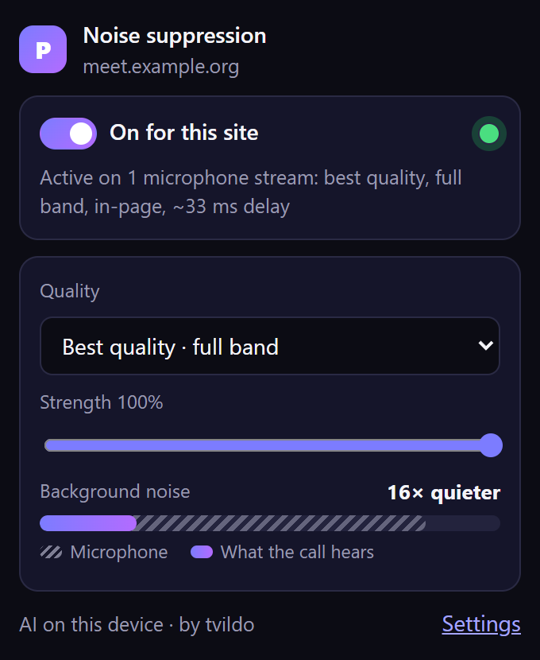
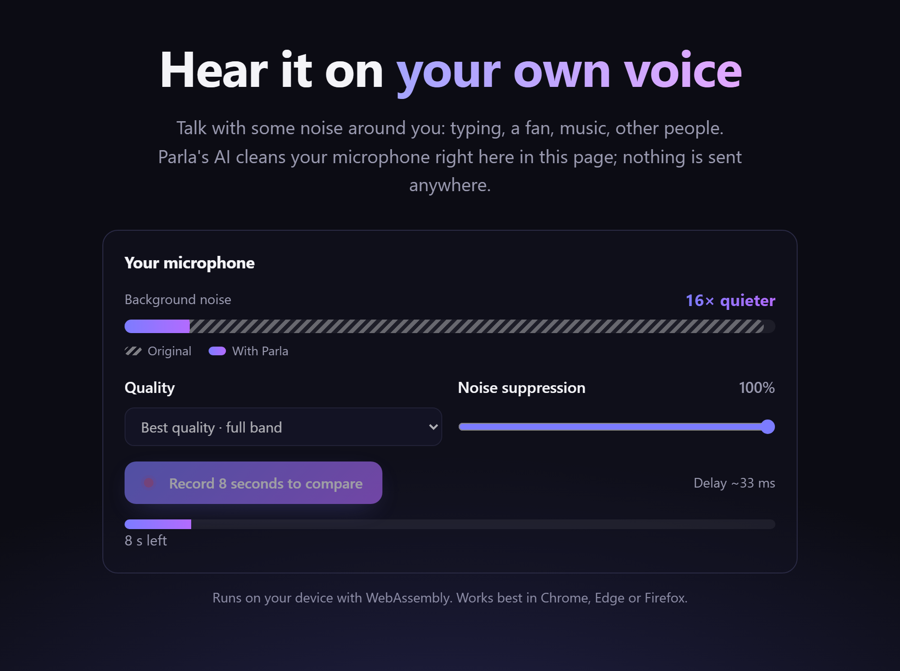
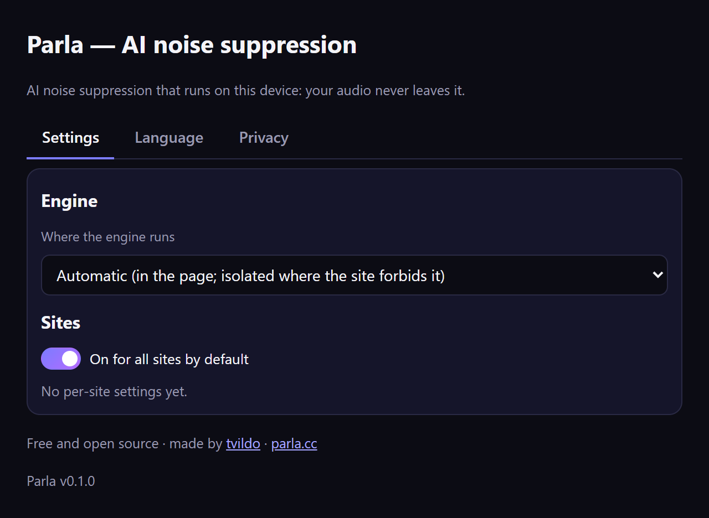

<div align="center">

# Parla

**Clear voice in every web call.**

Parla removes background noise and other people's voices from your microphone — in Google Meet, Microsoft Teams,
Zoom, Discord and any other website you call from. The AI runs on your own computer: your voice never leaves it.

**[🌐 parla.cc](https://parla.cc)** · **[Try it in your browser](https://parla.cc/demo/)** · **[Install](#install)** · **[For developers](#for-developers)** · **[Docs](docs/README.md)**

Free · Open source · No account · No sign-up

</div>

## What it does

- 🎧 **Removes noise and background voices**: keyboards, fans, traffic, music, a TV, colleagues talking nearby.
- 🔒 **Private**: everything happens in your browser, on your device. Nothing is uploaded or recorded.
- 🌐 **Works everywhere you call**: no app to change, no settings in the call. Turn it on or off per site.
- 🎚️ **You stay in control**: three quality levels and a strength slider, right in the toolbar.
- 📊 **See it work**: a live meter shows your microphone against what the call hears, and how much quieter the
  background noise is.
- 🛟 **Never in the way**: if anything goes wrong, your call just keeps the normal microphone. Updates wait until
  your call is over.
- 🗣️ **21 languages**: English, 简体中文, 繁體中文, हिन्दी, Español, Français, العربية, বাংলা, Português, Русский, اردو,
  Bahasa Indonesia, Deutsch, 日本語, मराठी, తెలుగు, Türkçe, தமிழ், Tiếng Việt, 한국어, ქართული.

<table>
<tr>
<td width="40%" valign="top">

**The extension during a call**



</td>
<td valign="top">

**Hear the difference: the live demo**



</td>
</tr>
</table>

## Install

- **Chrome, Edge, Brave, Opera**: [Chrome Web Store](https://chromewebstore.google.com/detail/iifachdagbndcbloopehiagjopjkohei)
- **Firefox** (140+): [Firefox Add-ons](https://addons.mozilla.org/firefox/addon/parla-ai-noise-suppression/)
- **Safari** (macOS, iPhone, iPad): coming to the App Store

Free, no account, and it updates itself. You can also load the files of the
[latest release](https://github.com/tvildo/parla/releases/latest) yourself:
[installing the extension](docs/extension.md#install). Want to hear it first? The
**[live demo](https://parla.cc/demo/)** runs right in your browser, nothing to install.

Once installed, join a call: the Parla icon shows **ON** while it cleans your microphone. Click it to see the noise
meter and to change quality or strength. The settings page has three tabs: **Settings** (on for all sites by
default, per-site choices, where the engine runs), **Language** and **Privacy**.



## For developers

Build your own noise-cancellation app with the same engine. The npm package contains everything — the engine and
the AI models — and runs on the user's device:

```js
import { Parla } from '@tvildo/parla';

const parla = await Parla.load();
const ns = await parla.process(micTrack);        // micTrack from getUserMedia
peerConnection.addTrack(ns.track);               // send the cleaned voice
ns.onVoice = ({ speaking }) => showTalking(speaking);
```

There is a React hook too (`useParla`). Start here: **[developer docs](docs/README.md)** — getting started,
features (speech detection, strength, quality levels, device changes), React, the npm package, API reference, and
how to build and test this project. Runnable examples: [`examples/vanilla`](examples/vanilla) (one HTML file, no
build step) and [`examples/react-vite`](examples/react-vite). Every [release](https://github.com/tvildo/parla/releases)
also has the npm package and the SDK as plain files to download.

## Privacy

Your voice is processed on your device and never uploaded. There is no account. The extension sends nothing unless
you turn on its anonymous technical reports (errors and performance, nothing about you or the pages you visit) in its
settings, to help fix problems. Detailed diagnostics (which site a problem happened on: its domain only) are off
too unless you turn them on. The website has no cookies or trackers. Details: [privacy](https://parla.cc/privacy/),
[what exactly is sent](docs/telemetry.md).

## Contributing

Bug reports, translations and code are welcome. Translations are one file per language in [`src/i18n`](src/i18n);
most are drafts waiting for a native speaker. Building, testing and the project layout:
[docs/development.md](docs/development.md); branches, versions and releases: [docs/releasing.md](docs/releasing.md).

## License

[Apache-2.0](LICENSE). The AI models are open models from their authors under their own permissive licences
([NOTICE](NOTICE)). Made by [tvildo](https://github.com/tvildo).
